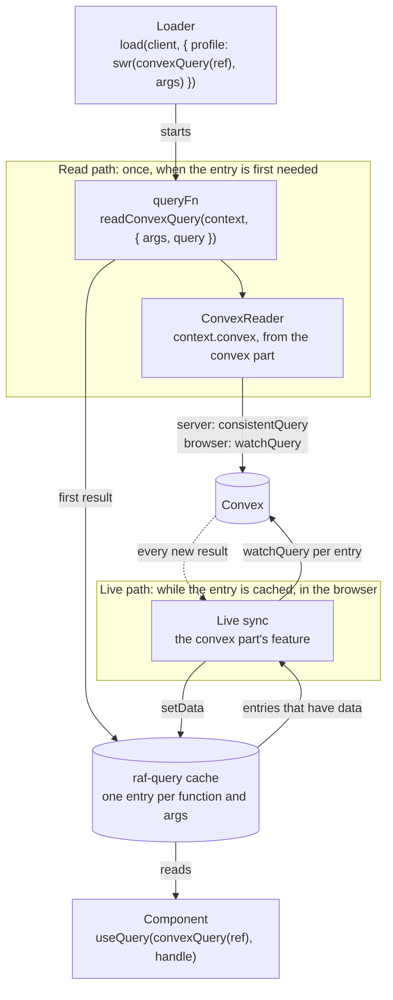
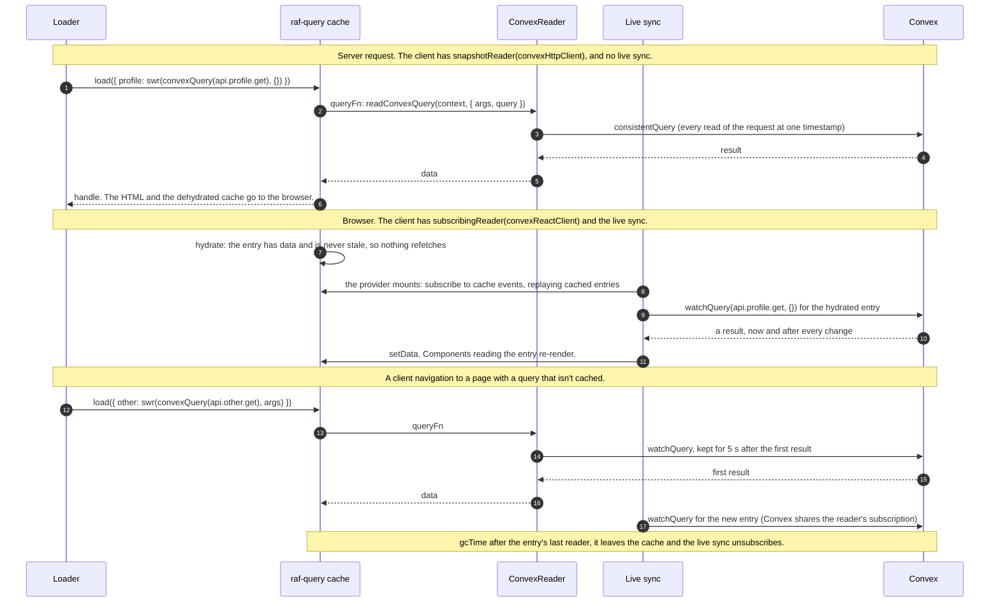
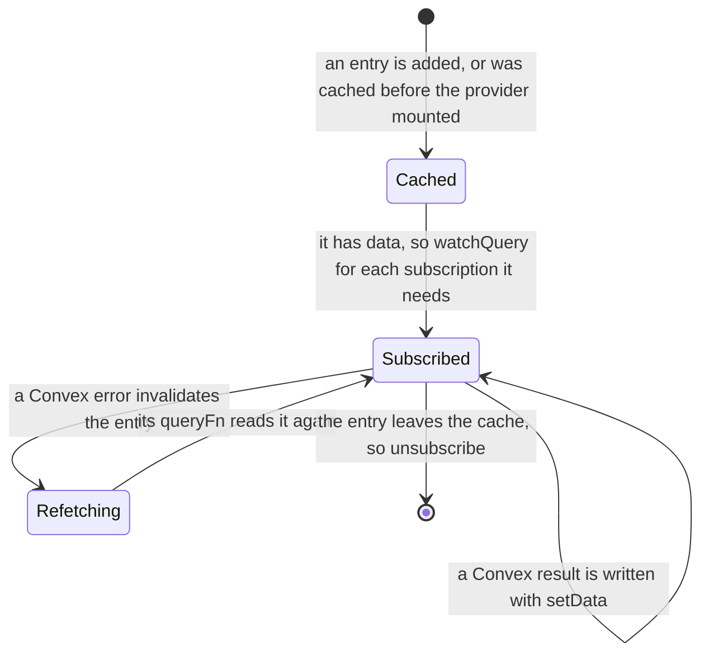
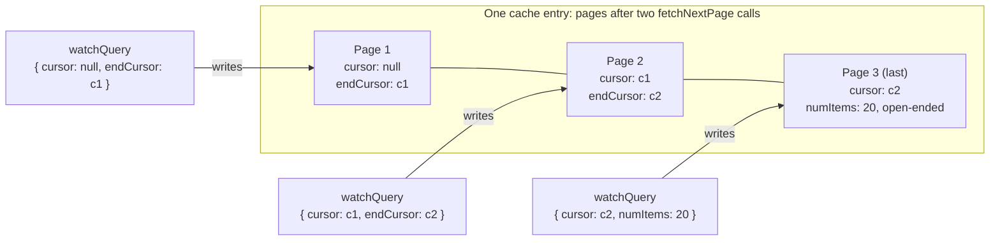
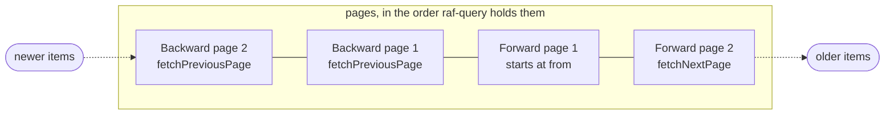

# Convex for raf-query

Convex queries as [raf-query](https://raf-query.katt.dev) query factories:
loaders `load` them for SSR and instant client navigation, and the `convex`
part keeps every cached entry subscribed, so components read plain `useQuery`
data that Convex keeps current.

- [Wiring](#wiring)
- [Usage](#usage)
- [How it works](#how-it-works)
  - [The pieces](#the-pieces)
  - [One query, from the server to live](#one-query-from-the-server-to-live)
  - [Keys and factories](#keys-and-factories)
  - [Readers](#readers)
  - [The live sync](#the-live-sync)
  - [Paginated queries](#paginated-queries)
  - [Two-way paginated queries](#two-way-paginated-queries)
- [Waiting for a value](#waiting-for-a-value)
- [Testing](#testing)

## Wiring

```tsx
const queryClient = createQueryClient({
  parts: [
    ...recommended(),
    isServer
      ? // One consistent snapshot per request; features never run on a server.
        convex({ live: null, reader: snapshotReader(convexHttpClient) })
      : // `live` keeps cached entries subscribed while a `QueryClientProvider` has the client mounted.
        convex({ live: convexReactClient, reader: subscribingReader(convexReactClient) }),
  ],
});
```

The factories are bound to the part, so they run on any client that has it,
whatever else the client has. A client without it is a type error where it
meets a factory: in `load`, `setData` and the other verbs. `ConvexQueryClient`
is the type of a client that has the part.

An app's own queries that read Convex are built with `queryOptions` bound to
the app's client (`bindQueryOptions<typeof makeQueryClient>()`), which types
`context.convex` for `readConvexQuery`.

## Usage

Call the factories inline with a function reference; there is no registry to
maintain. Every call for one function returns the same factory (raf-query
matches factory targets by identity), and entries are keyed by function name
and args.

Loaders name their queries in one `load` and return the handles; `swr` waits
until the cache has data (Convex data is live, so cached data is current).
Components read the handle with `useQuery` and `use()`:

```tsx
loader: async (opts) => {
  const [handles] = await load(opts.context.queryClient, {
    profile: swr(convexQuery(api.profile.get), {}),
    timeline: swr(convexPaginatedQuery(api.timeline.listByBaby), {
      args: { babyId },
      numItems: 20,
    }),
  });
  return handles;
},

const [profileThenable] = useQuery(convexQuery(api.profile.get), loaderData.profile);
const profile = use(profileThenable);
const [timelineThenable, timeline] = useInfiniteQuery(
  convexPaginatedQuery(api.timeline.listByBaby),
  loaderData.timeline,
);
```

The query functions reject with a `ConvexQueryError` whose message is the
Convex error's, so error boundaries show what the function threw. Factories
never go stale (`staleTime: Infinity`) and don't retry (`retry: false`, on a
client that has `retry()`).

Type props that receive a loader handle with `ConvexQueryHandle<typeof
api.profile.get>` or `ConvexPaginatedQueryHandle<typeof
api.timeline.listByBaby>`.

Read data in a loader from `load`'s second element (`const [, data] = await
load(…)`). A `queryFn` that composes several reads (for example
push-capability detection) calls `readConvexQuery(context, { args, query })`
for each.

## How it works

The package is plain TypeScript: it ships in the browser bundle, so it doesn't
use Effect.

### The pieces

```
reader.ts   ConvexReader: subscribingReader for the browser, snapshotReader for a server request
context.ts  Convex: what the part declares, the reader in every queryFn's context
            readConvexQuery: read a query from a queryFn, through the client's reader
part.ts     convex: the client's part, its reader and (in the browser) the live sync
queries.ts  convexQuery / convexPaginatedQuery factories, bound to the part
live.ts     the live sync: subscribes cached entries and writes results into the cache
            watchConvexQuery: one entry's values, as they change
entries.ts  key constants, and decoding a cache entry's key and page params
testing.ts  makeTestConvexClient: a watch client over any async runner (convex-test)
```



Two paths write an entry. The **read** path runs once, when a loader or a
component first needs the entry: the factory's `queryFn` asks the client's
reader. The **live** path runs for as long as the entry is cached in a
mounted browser client: the live sync holds a Convex subscription for it and
writes every result into the cache. Components only ever read the cache.

### One query, from the server to live



A navigation to a page whose queries are cached makes no request at all:
`swr` finds data that is never stale (`staleTime: Infinity`), and the live
sync has kept it current.

### Keys and factories

| Factory                       | Entry key                                                | Input                                                |
| ----------------------------- | -------------------------------------------------------- | ---------------------------------------------------- |
| `convexQuery(query)`          | `["convexQuery", functionName, args]`                    | the function's args                                  |
| `convexPaginatedQuery(query)` | `["convexPaginatedQuery", functionName, args, numItems]` | `{ args, numItems }`, and `from` for a two-way query |

- The key holds everything the live sync needs to subscribe again: the
  function name and the args. `entries.ts` decodes an entry's key (`liveKey`)
  and a paged entry's page params (`loadedPages`), and returns `null` for
  anything this package's factories didn't make, so the sync leaves other
  entries alone.
- Factories are memoized by function name. raf-query matches a factory target
  by identity, so `invalidateMany(client, convexQuery(api.profile.get))`
  reaches entries another call of `convexQuery(api.profile.get)` created.
- A two-way query's `from` is not in the key. It rides in the page params, so
  one entry serves every start ([below](#two-way-paginated-queries)).
- Every factory sets `staleTime: Infinity` and `retry: false`. Its builder is
  bound with `bindQueryOptions<Convex & Optional<Retry>>()`: it needs the
  `convex` part, and sets `retry` only where the client has `retry()`.

### Readers

A `ConvexReader` has one method, `query({ args, query, signal })`, which
resolves with the result or rejects with a `ConvexQueryError`. The `convex`
part puts the client's reader in every `queryFn`'s context as
`context.convex`, and `readConvexQuery` passes it the request's `signal`.
Each `QueryClient` takes its own part, which keeps a server request's
authenticated `ConvexHttpClient` scoped to the request.

| Reader                                 | For              | How it reads                                                                       |
| -------------------------------------- | ---------------- | ---------------------------------------------------------------------------------- |
| `snapshotReader(convexHttpClient)`     | a server request | `consistentQuery`, so every read of the request sees one timestamp                 |
| `subscribingReader(convexReactClient)` | the browser      | `watchQuery`: resolves with the first result, at once if the client already has it |

The subscribing reader keeps its subscription for 5 seconds after the first
result. The live sync subscribes to the same query as soon as the cache has
the data, and Convex shares one subscription between the two, so the query
isn't sent twice. If raf-query aborts the request first (the entry was
removed), the reader unsubscribes and rejects with the signal's reason.

### The live sync

The `convex` part's feature. Like every raf-query feature it runs while a
`QueryClientProvider` has the client mounted, so never on a server.



- It listens to the client's cache events with `replay: true`, so entries a
  loader or hydration cached before it started are picked up.
- For each entry it works out the subscriptions the entry needs
  (`subscriptionsFor`): one for a `convexQuery` entry, one per loaded page
  for a paginated one. It keeps them in a map, entry hash → subscription id →
  watch, and on every event for the entry adds the missing ones and drops the
  ones no longer wanted.
- A result is written with `setData`, which notifies the entry's readers. A
  write re-enters the sync (the cache emits `updated`), so a subscription is
  claimed in the map before `watchQuery` is called.
- A subscription that throws invalidates the entry (`invalidateOne`). A read
  entry then refetches through its `queryFn`, and the error reaches the
  component's error boundary from there.
- An entry without data has no subscription: its first read is the
  `queryFn`'s.

### Paginated queries

`convexPaginatedQuery` is an infinite query over Convex `paginate`. Pages
load with `fetchNextPage`; each page's `pageParams` entry is the
`{ cursor, numItems }` it was loaded with.

Live, every loaded page has its own subscription, and every page except the
last is **pinned**: it ends where the next page starts (`endCursor`), instead
of holding `numItems` items.



An item inserted or deleted inside page 1 grows or shrinks page 1. Without
the pin, each page would re-run its original `numItems` window, and items
would shift across page boundaries, leaving gaps and duplicates between
pages.

A subscription's id is its cursor and end cursor. When `fetchNextPage` adds
page 4, page 3 gets an end cursor: its open-ended subscription is replaced by
a pinned one, and page 4 gets the open-ended one. A page result is written to
the page that still starts at that cursor, and dropped if that page is gone.

### Two-way paginated queries

A paginated query that also takes `direction` and `from` reads both ways
(`TwoWayPaginatedQueryReference`). Its input says where the pages start,
`{ args, from, numItems }`, with `from` an item's id or `null` for the top.



- Forward pages read on from the start (`fetchNextPage`). Backward pages read
  the other way from right before it (`fetchPreviousPage`), and raf-query
  prepends them, so each page's `pageParams` entry says which `direction` it
  came from.
- Each page says what's `before` it that isn't loaded (`{ count, more }`):
  the first forward page what's before the start, each backward page what's
  still before it, other forward pages `null`. `hasPreviousPage` follows the
  top page's `before`, and the count is there for a "Show N more" control,
  live like the rest of the page.
- Both directions stay live and pinned the same way, as two chains of
  subscriptions: forward from the start, and backward from it. A backward
  page that is full never takes in items beyond it until the next
  `fetchPreviousPage`.
- To open with a little context before an item, let the query start a few
  items early.

`from` rides in the page params, not the key, so a two-way query is one entry
however it was opened. The factory sets raf-query's `keepPages`: `load` keeps
the cached pages while they start at `from` or show the item `from` names
(its items have an `_id`), and starts them over at `from` otherwise. Moving
between items the page already shows (a highlighted link, back and forward)
then reads nothing and keeps every page loaded, with no state beyond the URL.

A router that preloads links runs loaders for links to other starts too, and
that would start the pages on screen over. Keep the start on links that lead
back to the page, and don't preload the ones meant to start over; or load the
entry with `prefetch` while preloading, which never drops pages.

## Waiting for a value

`watchConvexQuery({ client, queryClient }, { args, onValue, query })` calls
`onValue` with one entry's values: the cached value, then every change, until
the function it returns is called. It reads through the cache (so it shares
the request with loaders' `load`) and holds its own Convex subscription while
it runs, writing each result into the entry, so it doesn't depend on the live
sync being mounted. Use it to wait for a value, for example the profile after
sign-in:

```ts
const signedIn = Promise.withResolvers<Profile>();
const stop = watchConvexQuery(
  { client, queryClient },
  {
    args: {},
    onValue: (me) => {
      if (me !== null) {
        signedIn.resolve(me);
      }
    },
    query: api.profile.get,
  },
);
```

## Testing

`makeTestConvexClient(run)` returns `{ client, refresh, subscriptions }`. Pass
`client` to `subscribingReader` and as the part's `live`, and call `refresh()`
after a write so live entries re-run, as the server would after a mutation.
`subscriptions()` lists the queries and args currently subscribed. Outside
React, `mount(queryClient)` from `@raf-query/core/internal` starts the
features, as `QueryClientProvider` does.
